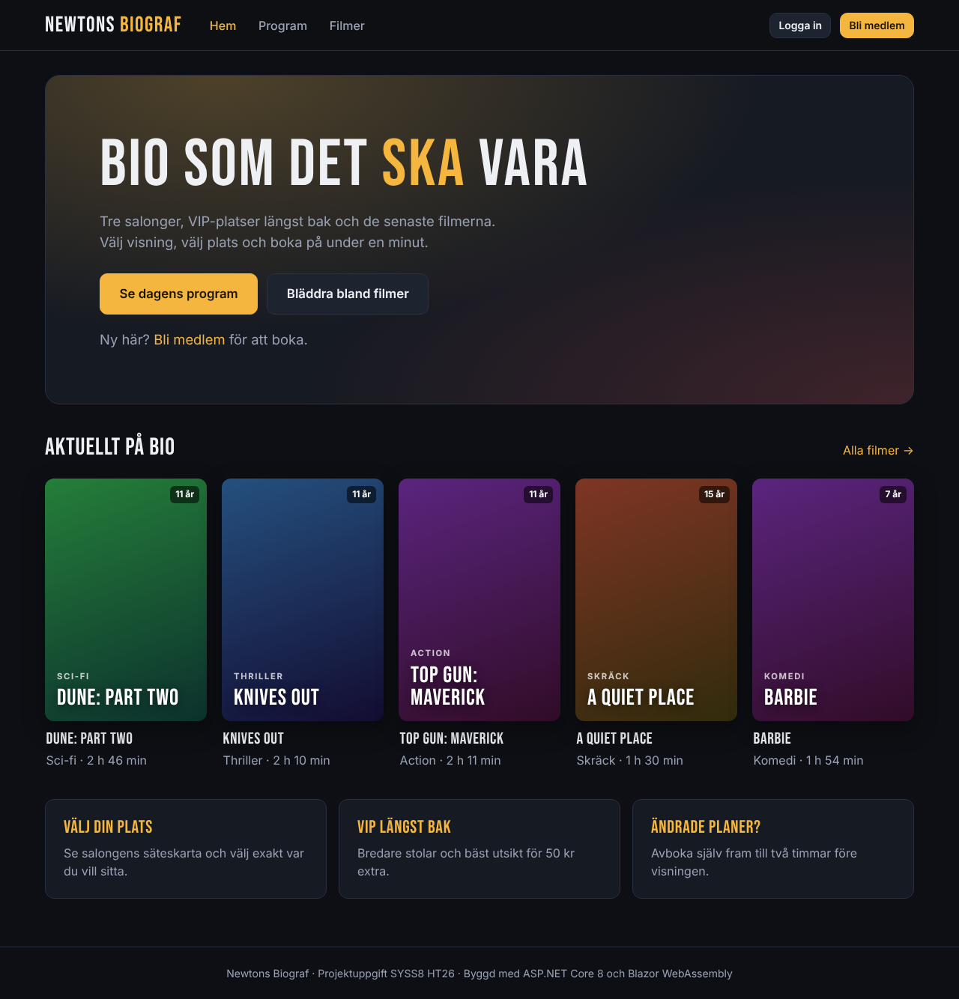
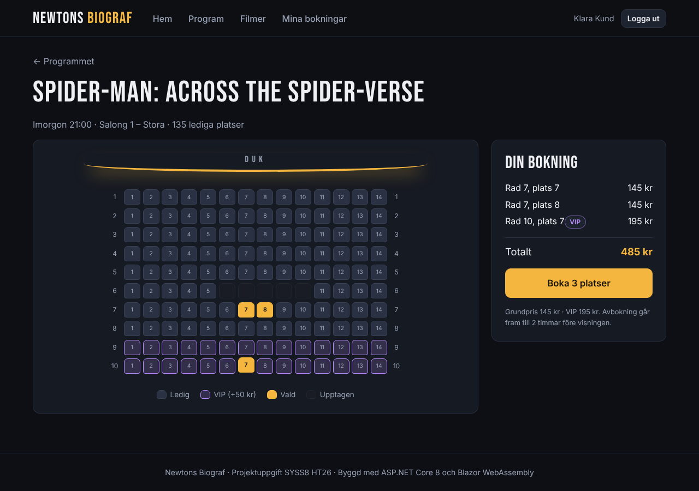
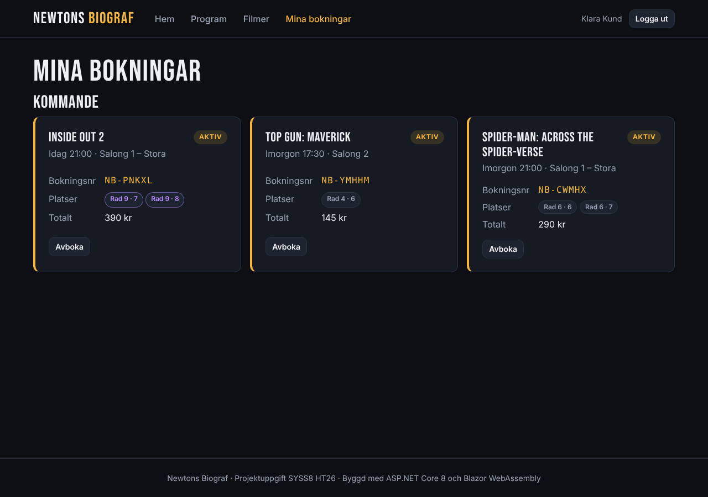
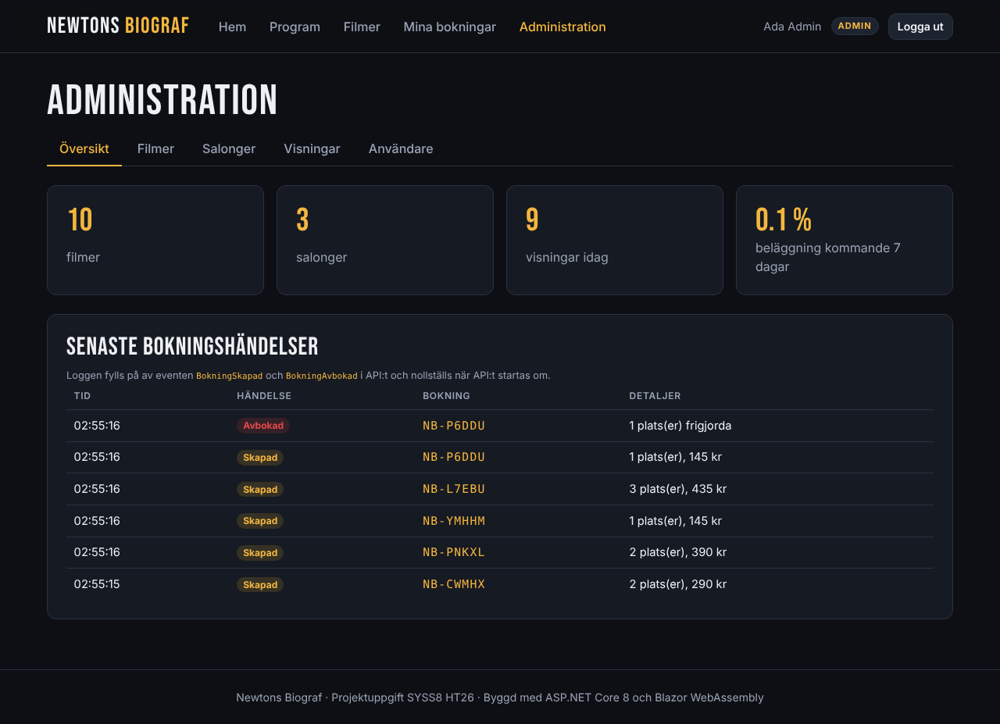

# Newtons Biograf

Ett biograf- och bokningssystem för en fiktiv biograf med flera salonger. Personalen lägger in filmer, salonger och visningar, och kunderna söker i programmet, väljer platser i en säteskarta och bokar och avbokar sina biljetter.

Projektuppgift i kursen *Ämnesövergripande projekt* (SYSS8, HT26) på Newton.



---

## Innehåll

- [Funktioner](#funktioner)
- [Teknik](#teknik)
- [Kom igång](#kom-igång)
- [Tre användarscenarier](#tre-användarscenarier)
- [Arkitektur](#arkitektur)
- [Generics, delegates/events, LINQ och async](#generics-delegatesevents-linq-och-async)
- [Tester](#tester)
- [Arbetssätt](#arbetssätt)

---

## Funktioner

| | Besökare | Kund | Personal | Admin |
|---|:-:|:-:|:-:|:-:|
| Se program, filmer och säteskartor, söka och filtrera | ✓ | ✓ | ✓ | ✓ |
| Registrera sig och logga in | ✓ | | | |
| Boka platser (standard eller VIP) | | ✓ | ✓ | ✓ |
| Se och avboka sina egna bokningar (fram till 2 h före) | | ✓ | ✓ | ✓ |
| Lägga till, ändra och ta bort filmer, salonger och visningar | | | ✓ | ✓ |
| Se alla bokningar för en visning och avboka åt kunder | | | ✓ | ✓ |
| Se bokningsloggen och nyckeltal | | | ✓ | ✓ |
| Skapa personalkonton och byta roller | | | | ✓ |

**Regler som systemet upprätthåller**

- Ett säte kan bara vara bokat en gång per visning. Det garanteras av ett unikt index i databasen, även vid samtidiga bokningar.
- VIP-platserna (de bakersta raderna) kostar grundpriset + 50 kr.
- Två visningar i samma salong får inte överlappa. Kontrollen räknar med filmens längd plus 20 minuters städtid.
- Kunden kan avboka fram till 2 timmar före visningen, och avbokade platser blir lediga igen.
- En salongs platslayout kan inte ändras när den har visningar, och filmer eller salonger med visningar kan inte tas bort.

## Teknik

| Del | Teknik |
|---|---|
| Backend | ASP.NET Core 8 Web API (controllers) |
| Databas | Entity Framework Core 8 + SQLite |
| Inloggning | ASP.NET Core Identity + JWT, rollbaserad auktorisering |
| Frontend | Blazor WebAssembly (egen design, inga UI-bibliotek) |
| Tester | xUnit, SQLite i minnet, `WebApplicationFactory` |

## Kom igång

**Krav:** [.NET 8 SDK](https://dotnet.microsoft.com/download/dotnet/8.0)

```bash
git clone https://github.com/danieljmnewton/biograf-daniel.git
cd biograf-daniel
dotnet dev-certs https --trust   # en gång, för https lokalt
```

Starta API:t och klienten i **två terminaler**:

```bash
dotnet run --project src/Biograf.Api --launch-profile https      # API + Swagger: https://localhost:7076/swagger
dotnet run --project src/Biograf.Client --launch-profile https   # Webbappen:     https://localhost:7071
```

I Visual Studio eller Rider väljer du *Multiple startup projects* och startar både `Biograf.Api` och `Biograf.Client`. Det fungerar med både `http`- och `https`-profilen, eftersom klienten väljer API-adress efter vilken profil den körs med.

### Testkonton

| Roll | E-post | Lösenord |
|---|---|---|
| Admin | admin@biograf.se | Admin123 |
| Personal | personal@biograf.se | Personal123 |
| Kund | kund@biograf.se | Kund123 |

Inloggningssidan har snabbval som fyller i kontona.

### Databasen

Databasen `src/Biograf.Api/biograf.db` finns med i repot. Den innehåller 10 filmer, 3 salonger (296 platser), visningar 14–20 oktober 2026, testkontona och några demobokningar.

- Migrationer körs automatiskt när API:t startar.
- **Vill du ha nya visningsdatum?** Ta bort `biograf.db` och starta API:t. Då skapas databasen på nytt med en veckas visningar från och med idag (se `Data/DbSeeder.cs` och `Data/AnvandarSeeder.cs`).
- JWT-nyckeln i `appsettings.json` är en utvecklingsnyckel. I en riktig driftsättning ska den ligga i user-secrets eller en miljövariabel.

## Tre användarscenarier

### 1. Klara bokar biljetter till fredagens visning

Klara vill gå på bio med en kompis på fredag kväll och sitta bra.

1. Hon öppnar **Program**, väljer fredag i dagväljaren och filtrerar på genren *Action*.
2. Hon klickar på tiden 21:00 för *Top Gun: Maverick*. Säteskartan för Salong 1 visas med duken längst fram, de lediga platserna och de lila VIP-raderna längst bak. Upptagna platser går inte att välja.
3. Hon väljer två bredvid varandra i rad 9 (VIP). Sammanfattningen visar 195 kr per plats och totalt 390 kr.
4. Eftersom hon inte är inloggad står det **Logga in för att boka**. Hon registrerar sig, loggas in direkt och kommer tillbaka till samma visning.
5. Hon klickar **Boka 2 platser** och får bekräftelsen med bokningsnumret, t.ex. `NB-7K2Q9`.



### 2. Klara får förhinder och avbokar

På fredag eftermiddag blir kompisen sjuk.

1. Klara öppnar **Mina bokningar**. Bokningen ligger under *Kommande* med status **Aktiv**.
2. Hon klickar **Avboka** och bekräftar med **Ja, avboka**.
3. Bokningen flyttas till *Tidigare och avbokade* och stryks över. Platserna blir genast lediga i säteskartan för andra kunder.
4. Hade det varit mindre än två timmar kvar till visningen hade knappen saknats, och det hade stått att avbokningen stängt. Då kan personalen i kassan fortfarande avboka.



### 3. Personalen planerar nästa veckas program

Biografen har fått in en ny film. Admin Ada har skapat ett personalkonto åt Per under **Administration → Användare**.

1. Per loggar in och går till **Administration → Filmer → + Ny film**. Han fyller i titel, genre, åldersgräns (11 år), längd och beskrivning och sparar.
2. Under **Visningar** försöker han lägga filmen i Salong 1 torsdag 15 oktober kl. 15:00. Systemet svarar: *"Salongen är upptagen: The Batman visas 14:00 till 16:56 (+20 min städning)."*
3. Han lägger den i stället onsdag 21 oktober kl. 19:00, en dag som ännu inte har något program, och visningen sparas.
4. Dagen därpå klickar han på antalet bokade platser för visningen och ser alla bokningar med kundnamn och intäkt. På **Översikt** ser han de senaste bokningshändelserna.



## Arkitektur

```
┌──────────────────────────┐   HTTP + JSON, JWT i     ┌──────────────────────────────────────────┐
│  Biograf.Client          │   Authorization-headern  │  Biograf.Api                             │
│  Blazor WebAssembly      │ ───────────────────────► │                                          │
│                          │                          │  Controllers   (HTTP, rollskydd)         │
│  Pages/      sidor       │                          │      │                                   │
│  Komponenter/ återanv.   │                          │      ▼                                   │
│  Services/   ApiKlient,  │                          │  Services      (affärsregler,            │
│     JwtAuthStateProvider │                          │      │          Resultat<T>, events)     │
└────────────┬─────────────┘                          │      ▼                                   │
             │                                        │  Data          (BiografDbContext, seed,  │
             │      ┌──────────────────────┐          │      │          migrationer)             │
             └────► │  Biograf.Shared      │ ◄────────┤      ▼                                   │
                    │  DTO:er, Roller,     │          │  SQLite  biograf.db                      │
                    │  Priser, validering  │          └──────────────────────────────────────────┘
                    └──────────────────────┘
```

- **Biograf.Shared** delar DTO:er, rollnamn, prisregler och valideringsattribut mellan API och klient, så att formulären i klienten validerar med samma regler som API:t.
- **Controllers** är tunna: de tar emot anropet, kontrollerar roll och skickar vidare till en tjänst.
- **Services** innehåller reglerna. De returnerar `Resultat<T>` i stället för att kasta undantag för förväntade fel, och `TillSvar()` översätter resultatet till 200/201/204/400/404/409.

**Datamodell**

```
Film 1──* Visning *──1 Salong 1──* Sate
             │
             1
             │
             *
          Bokning *──1 Anvandare (Identity)
             │
             1──* BokadPlats *──1 Sate      unikt index: (VisningId, SateId) där Aktiv = 1
```

```
src/
  Biograf.Api/
    Common/        Resultat<T> och översättning till HTTP-svar
    Controllers/   Auth, Admin, Filmer, Salonger, Visningar, Bokningar
    Data/          DbContext, seeders, migrationer, biograf.db
    Models/        EF-entiteter
    Services/      FilmTjanst, SalongTjanst, VisningTjanst, BokningTjanst, BokningsLogg, TokenTjanst
  Biograf.Client/
    Komponenter/   Sateskarta, FilmPoster, BokningsKort, VisningsKnapp …
    Layout/        MainLayout, Navmeny
    Pages/         Hem, Programsida, Filmer, Film, Boka, MinaBokningar, Admin/…
    Services/      ApiKlient, JwtAuthStateProvider, TokenLagring, Datumtext, Url
  Biograf.Shared/  DTO:er, Roller, Priser, Bokningsregler
tests/
  Biograf.Tests/   31 scenariotester
docs/
  testscenarier.md
```

## Generics, delegates/events, LINQ och async

Uppgiften kräver minst tre av teknikerna. Alla fyra används:

| Teknik | Var | Vad |
|---|---|---|
| **Generics** | `Api/Common/Resultat.cs` | `Resultat<T>` bär antingen ett värde eller ett fel. `Map<TNy>()` och `FelSom<TNy>()` byter typ utan att förlora felet. |
| | `Api/Common/ResultatExtensions.cs` | `TillSvar<T>()` gör om vilket resultat som helst till ett HTTP-svar |
| | `Client/Services/ApiKlient.cs` | `GetAsync<T>`, `PostAsync<T>` … returnerar `ApiSvar<T>`, och samma kod används för alla anrop |
| **Delegates och events** | `Api/Services/BokningTjanst.cs` | Eventen `BokningSkapad` och `BokningAvbokad` (`EventHandler<BokningEventArgs>`) |
| | `Api/Services/BokningsLogg.cs` | Prenumererar på eventen med lambdas och visar händelserna i adminöversikten |
| | `Api/Services/VisningTjanst.cs` | Krockkontrollen är en `Func<Visning, bool>` |
| | `Client/Komponenter/Sateskarta.razor` | `EventCallback` meddelar sidan när platsvalet ändras |
| **LINQ** | `Api/Services/FilmTjanst.cs` | Frågan byggs upp steg för steg med valfria filter och projiceras direkt till DTO i SQL |
| | `Api/Controllers/AdminController.cs` | `Join` mot Identitys roll-tabeller |
| | `Api/Services/SalongTjanst.cs` | Layouten (rader, VIP-rader) räknas fram ur sätena |
| | `Client/Pages/Programsida.razor` | `GroupBy` per film, sorterat på första visningen |
| **Async** | Hela kedjan | Alla databas- och HTTP-anrop är `async`/`await` |
| | `BokningTjanst.SkapaAsync` | Asynkron databastransaktion |
| | `Client/Pages/Admin/Oversikt.razor` | `Task.WhenAll` hämtar fyra resurser parallellt |
| | `Client/Pages/Filmer.razor` | Sökning med fördröjning via `Task.Delay` och `CancellationTokenSource` |

## Tester

```bash
dotnet test     # 31 tester
```

Testerna är skrivna som scenarier (Givet/När/Så) och dokumenterade i **[docs/testscenarier.md](docs/testscenarier.md)**. De täcker:
- bokningsregler, med dubbelbokning både i tjänsten och via databasens unika index
- visningskrockar
- salonger och filmregistret
- inloggning och rollskydd via riktiga HTTP-anrop

Tjänstetesterna körs mot SQLite i minnet, så att index och transaktioner fungerar som i den riktiga databasen.

## Arbetssätt

- **Scrum i fyra sprintar.** Backloggen bestod av user stories med acceptanskriterier som GitHub-issues (#1–#15), planerade med en milestone per sprint och en GitHub Projects-board (Backlog → Ready → In progress → In review → Done).

| Sprint | Datum | Innehåll | Issues | PR:er |
|---|---|---|---|---|
| 1 – Grund | 13 okt | Projektstruktur, datamodell, seed-data | #1–#3 | #16–#18 |
| 2 – Auth & admin | 13 okt | Identity + JWT, roller, användarhantering, CRUD för filmer, salonger och visningar | #4–#8 | #19–#23 |
| 3 – Frontend | 13 okt | Boknings-API, design, sök och filter, säteskarta, mina bokningar, adminpanel | #9–#13 | #24–#29 |
| 4 – Kvalitet | 14 okt | Tester, dokumentation, databas | #14–#15 | #30–#31 |

- **Git:** en branch per issue (`feature/<nr>-<namn>`) och små commits med beskrivande meddelanden på svenska. Varje issue mergades till `main` via en pull request med beskrivning och testresultat, och PR:en stängde sitt issue.
- **Roller:** projektet gjordes individuellt, så samma person hade rollerna Scrum Master, Tech Lead och testansvarig.
- **AI-stöd:** projektet har utvecklats med [Claude Code](https://claude.com/claude-code) som AI-parprogrammerare. Commits som skrivits tillsammans med AI:n är märkta `Co-Authored-By: Claude`, och `CLAUDE.md` innehåller projektets riktlinjer för AI-stödet.
